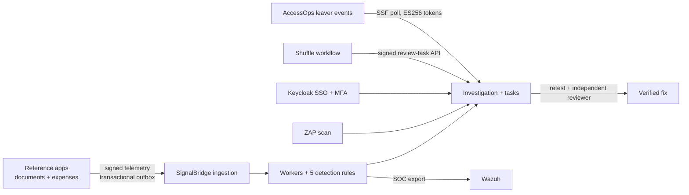
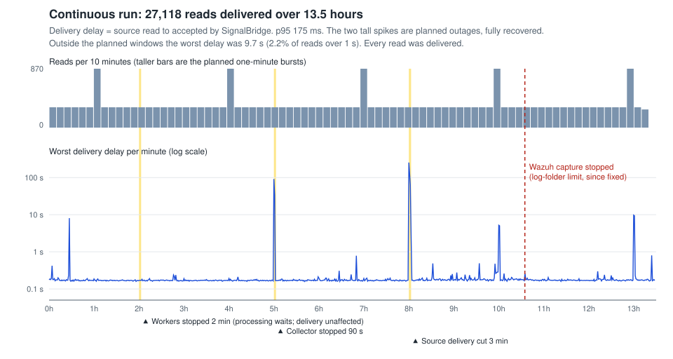

# SignalBridge

**Detection engineering for identity attacks: who still has access, and who is trying to get it.**

[Identity detections](detections/identity/README.md) · [Case study](https://aman-agarwal6.github.io/projects/signalbridge.html) · [Evidence guide](docs/EVIDENCE.md) · [Lessons learned](docs/LESSONS.md) · [Releases](https://github.com/aman-agarwal6/signalbridge/releases)

## At a glance

- **13 Sigma rules for identity attacks**, including password spraying, Kerberoasting, MFA fatigue, device code phishing and backdoored app credentials. They read Windows domain controller and Microsoft Entra ID logs. On 23 public attack captures they flagged 18 of the 21 attack files they target, with no alerts on files a rule wasn't meant for (12 of the 13 rules had test data).
- **Community rules checked on the same captures.** Three of SigmaHQ's Entra rules (device code, Temporary Access Pass, app credentials) can't fire on these captures' export format. SigmaHQ's Kerberoasting rule and my own first version both missed Kerberoasting run as SYSTEM.
- **Access that should have ended.** In the lab, a planted authorization bug let a removed member read a private document, and rule R3 opened the investigation. Testing also found a stale permission check: when a user was downgraded, removed or disabled mid-request, all 4 test writes still went through. Permissions are now re-checked inside the database transaction.
- **Works with [AccessOps](https://github.com/aman-agarwal6/AccessOps).** SignalBridge verifies AccessOps' signed leaver events. When a departed test account was re-enabled and used, it opened a critical case.

## Identity attack detections

Scored on [Splunk's attack_data](https://github.com/splunk/attack_data) captures, which I didn't write, beside SigmaHQ's rules for the same attacks. Inputs are pinned by SHA-256, and CI re-scores them on every change.

| | My rules (12 with test data) | SigmaHQ's rules (9 with test data) |
| --- | --- | --- |
| Attack files flagged | **18 of 21** | 6 of the 12 their rules cover |
| Alerts on files a rule wasn't meant for | 0 | 0 |

E8 (disabled-account sign-in) and one SigmaHQ rule have no public capture to catch yet; both still ran on every sign-in capture without firing. I wrote down which rules should fire on each file before the first scoring run, except W5, which I added after it.

My rules miss one RC4 ticket (by design; SigmaHQ's rule catches it), a spray spread across many addresses, and an account with only two MFA failures. Rules, findings, the first run and the two changes after it are in the [identity detections README](detections/identity/README.md).

## The access lab

Two test apps send signed events about who tried to read what. Five detection rules flag access that continues after a permission was removed, and an analyst takes each finding to a fix that someone else verifies. I ran it against real Keycloak, Wazuh, OWASP ZAP and Shuffle in an isolated lab.



### What testing found

| Problem | Before the fix | Now |
| --- | --- | --- |
| Stale permission check | Case writes used a permission check made earlier in the request. When a test downgraded, removed or disabled the user after that check, all 4 writes went through | Permissions re-checked inside the database transaction; 13 [regression tests](tests/test_authorization_refresh.py) ([record](docs/evidence/20260925-authorization-refresh.json)) |
| Sign-in blocked | A keyboard-only browser test showed the console's Content-Security-Policy blocked the redirect to Keycloak | Policy fixed, with its own regression test |
| Generated Splunk query | pySigma's Splunk output for R5 compiled, but Splunk refused to run it | Hand-written SPL with rolling windows; generated and hand-written queries labeled |
| Default lab password | Scanner triage flagged a known default database password in the Supabase lab running a test copy of my BetTail app; 3 backend services were set to publish host ports | All 8 database role passwords rotated and checked (32/32); host-port bindings 3 → 0; memory and CPU capped ([record](docs/evidence/20260925-bettail-hardening-complete.json)) |
| Wazuh log limit | The collector stopped at 10.6 hours of a planned 24-hour run | Log-folder limit fixed |

[Lessons learned](docs/LESSONS.md) covers each of these and the other failures the lab runs uncovered.

### Results

October 1–5, 2026, with synthetic data. The runs used real components (PostgreSQL, Keycloak, Wazuh, ZAP, Prometheus and Grafana, Chromium) in an isolated lab; the detection evaluation runs in memory. Each row links the record its run wrote.

| Area | Result | Record |
| --- | --- | --- |
| Access assurance | 23 source events processed; a planted authorization bug let a removed member read a private document, and rule R3 opened one investigation | [b8667b81](docs/evidence/20261002-reference-access-b8667b816ce8419da7f3d5d9ac9d6ad6.json) |
| Sign-in and MFA | Keycloak password and TOTP: 28 protocol checks (replay, CSRF, app scoping, key rotation, back-channel logout, session expiry) and 5 keyboard-only Chromium checks | [73632025](docs/evidence/20261004-identity-native-73632025aeee400bb7ee49b69fba7c99.json) |
| Wazuh | 24 records archived and 8 alerts, each raised once; a recovery run survived a collector stop/restart and an input-file rotation with no extra copies | [0d137b47](docs/evidence/20261003-wazuh-native-collection-0d137b4720ad476faa68d36754b7357f.json), [4a5748dc](docs/evidence/20261003-wazuh-native-recovery-4a5748dcc7a74525a7469dc8d802438a.json) |
| ZAP | One finding on the faulty build, none after the fix; the console imported it on the right app only | [d975b97f](docs/evidence/20261003-authenticated-zap-offline-d975b97fad814c9b8e4304e114c776e5.json), [6bce0948](docs/evidence/20261003-console-restoration-6bce09482a3b430aadb98b589d40f04e.json) |
| Finding to fix | On a restored console: assigned, fix task, retest imported, self-review refused, independent reviewer approved | [de4f6409](docs/evidence/20261003-console-restoration-de4f6409fdf444a9bc22cf60463cdb05.json) |
| PostgreSQL | 14 concurrency and crash-recovery checks, including sign-in and reviewer races and a killed worker | [ed3829e7](docs/evidence/20261001-postgresql-in-network-ed3829e7b3dd45379d0c0290e324df85.json) |
| Monitoring | Prometheus and Grafana: backlog alerts fired and cleared; 24 checks passed | [0cd4256f](docs/evidence/20261003-monitoring-native-0cd4256f4a1c4f2692f67eae4704bd53.json) |
| Endurance | A compressed 40-minute run recovered from all five planned interruptions with every event delivered and seen by Wazuh. A continuous run delivered all 27,118 reads over 13.5 hours | [rehearsal](docs/evidence/20261004-reliability-rehearsal-8a1889fec8ef49f5acde3c01bfa88e63-remeasured.json), [continuous](docs/evidence/20261004-reliability-continuous-894fb388a2004b43b6b1643e93342df4-summary.json) |
| Shuffle | A Shuffle workflow in a VM with no network adapter ran nine scenarios against the signed review-task API: retries returned the original task; replayed, changed, wrong-app and stale requests were refused; a lost reply was recovered | [315cfb85](docs/evidence/20261005-shuffle-native-workflow-315cfb85-9c28-4e4e-9cac-8ce455e92448.json) |
| Leaver signals | Polled [AccessOps](https://github.com/aman-agarwal6/AccessOps)' signed Shared Signals events: 38 tokens across two live rounds verified (ES256), stored once, then acknowledged. Round one's 3 critical cases came from AccessOps' own intake test, which backdated each departure by 5 seconds. In round two, a contained test account was re-enabled and used, and SignalBridge correctly opened a critical "access after departure" case | [dry run](docs/evidence/20261005-accessops-leaver-dry-run-f567427abbbc4929ad50e25be2c84724.json), [round 1](docs/evidence/20261005-accessops-leaver-poll-eefe76ecded04ffe9892bd174c973232.json), [round 2](docs/evidence/20261005-accessops-leaver-poll-931402fb1ee44209b58c60063f63150f.json) |
| Accessibility | axe-core 4.13 on 16 console pages and the 3 evidence viewer pages in light and dark mode: 0 violations after fixing six issue types. The regenerated evidence viewer pages were rescanned on 27 October: 0 violations | [axe scan](docs/evidence/20261005-accessibility-axe-scan.json), [viewer rescan](docs/evidence/20261027-accessibility-axe-scan-viewer-2.json) |
| Detection | 48 scenarios: precision 15/21, recall 15/23, false-positive rate 6/18, 7 inconclusive | [evaluation](docs/evidence/20261005-enterprise-detection-evaluation-public-release.json) |
| Detection as code | R1–R5 rewritten as [Sigma rules](detections/README.md) with ATT&CK tags, plus SPL and KQL, each run on the same 48 scenarios. KQL in Microsoft's Kusto emulator matched the Python rules in 48; hand-written SPL in Splunk Free in 45 (events exactly on a window edge); compiled Sigma in 45 (re-grants it can't express) | [Splunk](detections/engines/splunk-run.json), [Kusto](detections/engines/kusto-run.json), [Sigma replay](detections/sigma/replay-report.json) |



## See it

| If you want to | Open |
| --- | --- |
| See each tool run with its record | [Evidence viewer](https://aman-agarwal6.github.io/signalbridge/portfolio/) |
| Watch the finding unfold | [Recorded access walkthrough](https://aman-agarwal6.github.io/signalbridge/portfolio/access-assurance.html) |
| Review the implementation | [Engineering reference](docs/DESIGN.md): code map, security boundaries, rules and verification |
| Check the security design | [Threat model](docs/THREAT_MODEL.md): trust boundaries, threats, controls and the test or run that checks each |
| Download a fixed version | [Releases](https://github.com/aman-agarwal6/signalbridge/releases): source archive, SBOM and Sigstore provenance, built only after CI passes on that commit |

## Run the lightweight console

Requires Node 24+ and Python 3.11+ (3.14 for the checks in `detections/`; CI uses 3.14). This local SQLite demo needs no Docker. From the repository root:

```powershell
python -m venv .venv
.venv\Scripts\python.exe -m pip install -r requirements-dev.txt
.venv\Scripts\python.exe -B scripts/sb.py doctor
.venv\Scripts\python.exe -B scripts/sb.py demo-core
```

`demo-core` starts the console at http://127.0.0.1:8741/ with clearly labeled synthetic fixtures; random local credentials are written to the ignored `var/local-access.txt` (keep it private). `scripts/sb.py up` reopens it and `scripts/sb.py down` stops it without losing data. On Linux/macOS use `.venv/bin/python`. The native lab stages need Docker and their own launchers; see the [engineering reference](docs/DESIGN.md#verification-and-operation).

## Limits

- Synthetic data in an isolated lab on one PC; not a production deployment.
- The identity rules ran on attack-lab captures through SQLite, not in a production SIEM. Zero alerts on other files is a misfire check, not a false-positive rate; their own [limits](detections/identity/README.md#limits) list the rest.
- I wrote the access lab's 48 evaluation scenarios knowing the rules, so those scores catch regressions rather than measure real-world accuracy.
- The planned 24-hour run ended after 13.5 hours, with Wazuh capturing the first 10.6. I started a replacement run and stopped it, so there is no full 24-hour result.
- The console trusts local administrators and must not be exposed publicly. See [SECURITY.md](SECURITY.md).

By [Aman Agarwal](https://aman-agarwal6.github.io/). MIT licensed.
